# bpnProject — Kliq Ailem

> 🇹🇷 Türkçe sürüm için bkz. [README.tr.md](./README.tr.md)

A mobile banking application module developed with React Native, focused on family banking ("Kliq Ailem"). Parents can add children to their family, manage per-child limits and permissions, and review account transactions. The app ships with a bottom-tab shell (Accounts, Cards, Transactions) and a dedicated family navigation stack covering the full onboarding → child list → child management flow.

## Table of Contents

- [Features](#features)
- [Screenshots](#screenshots)
- [Technology Stack](#technology-stack)
- [Project Structure](#project-structure)
- [Installation](#installation)
- [Environment Variables](#environment-variables)
- [Running the App](#running-the-app)
- [NPM Scripts](#npm-scripts)
- [Code Quality](#code-quality)
- [Developer Notes](#developer-notes)

## Features

- **Main tabs (Bottom Tabs)**: Navigation between `Accounts`, `Cards`, and `Transactions` tabs with a custom tab bar (`TabBar`) and header (`MainTabHeader`). The Accounts screen provides an entry point to the Kliq Ailem flow and a "Belleği Temizle" (clear storage) action to reset the onboarding state.
- **Family onboarding (dashboard)**: A slider-based introduction flow (`KliqFamilyOnboardingScreen`). Completion is persisted with `AsyncStorage`; the family stack's initial route is resolved at runtime (`useFamilyInitialRoute`) — onboarding if not completed, child list otherwise.
- **Child list**: Lists family members with avatars and status badges (`KliqFamilyListScreen`). The "Kliq Aileme Ekle" button is automatically disabled when the `maxAllowedChildren` limit is reached.
- **Add family member**: Form-driven child registration (`AddKliqFamilyMemberScreen`) built with `react-hook-form` + `zod` validation, including a masked phone input with a custom country-code selection modal. Duplicate registrations with the same national ID (TCKN) are prevented.
- **Limits & permissions**: Per-child limit and permission management (`KliqFamilyLimitAuthorityScreen`) with master/dependent toggle logic (`dependsOn`), confirmation modals (`requiresConfirmationOnEnable`), and hardware back-button guarding while there are unsaved changes.
- **Account transactions**: Transaction list and detail screens (`KliqFamilyTransactionScreen`, `KliqFamilyTransactionDetailScreen`) with date-range filtering (max 3-month window), empty states, and a context-aware "Listele"/"Temizle" filter button.
- **Server state & stores**: Data is fetched from a mock REST API (dummyjson custom responses) through a global `axios` instance and `@tanstack/react-query` hooks, then persisted into `zustand` stores (`childrenStore`, `familyLimitAuthorityStore`, `loadingStore`).
- **Global loading & error handling**: Axios interceptors drive a global `Loading` overlay (with a minimum display duration) and surface API errors through `react-native-toast-message`.
- **Shared component library**: Reusable, theme-aware components such as `Button`, `Text`, `TextInput`, `PhoneInput`, `DatePicker`, `SelectPicker`, `Toggle`, `Tabs`, `ListItem`, `InfoCard`, `InfoModal`, and `TransactionListItem`.
- **Theme system**: Centralized color palette and typography (Urbanist font family) provided via `styled-components` `ThemeProvider`.

## Screenshots

### Main Tabs

<p align="center">
  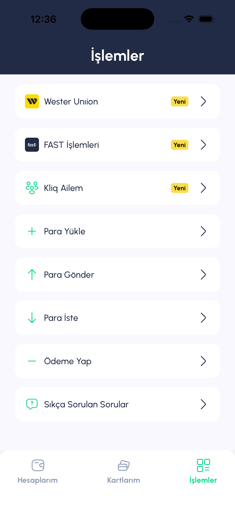
</p>

### Family Onboarding (Dashboard)

<p align="center">
  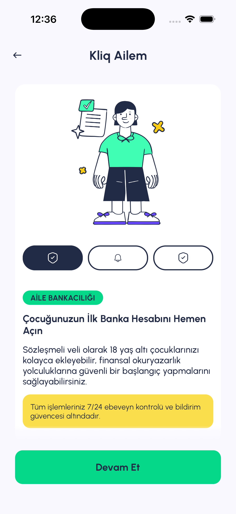
  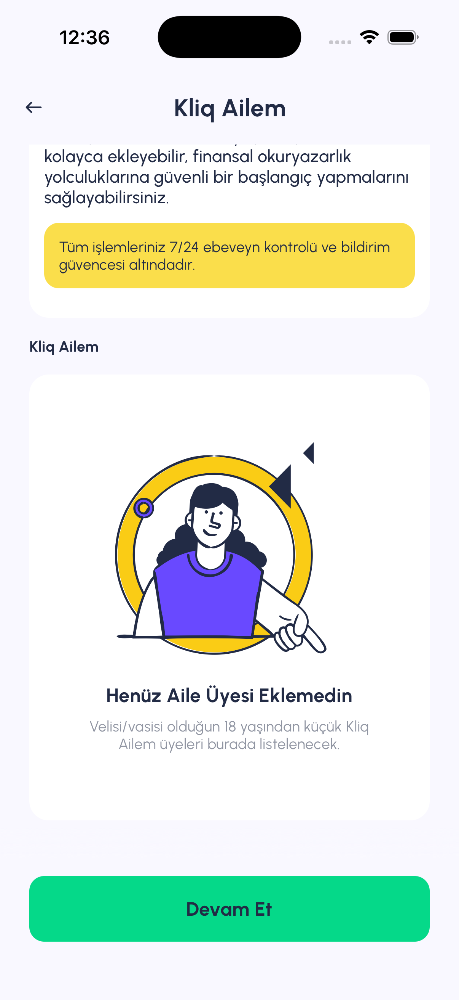
</p>

### Child List & Add Family Member

<p align="center">
  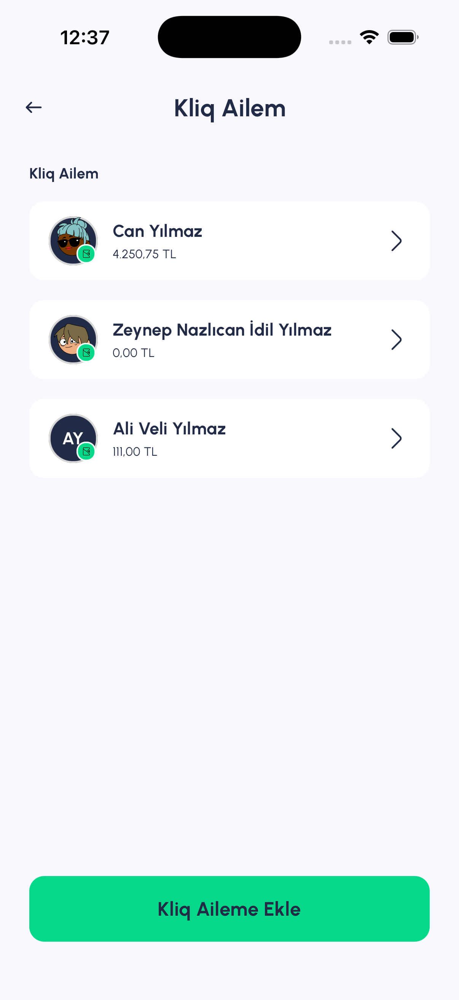
  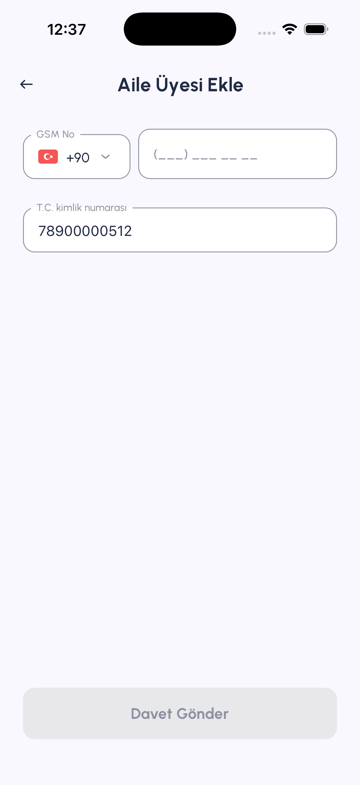
  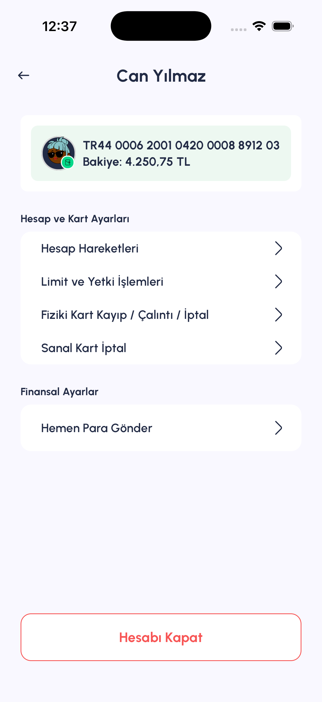
</p>

### Limits & Permissions

<p align="center">
  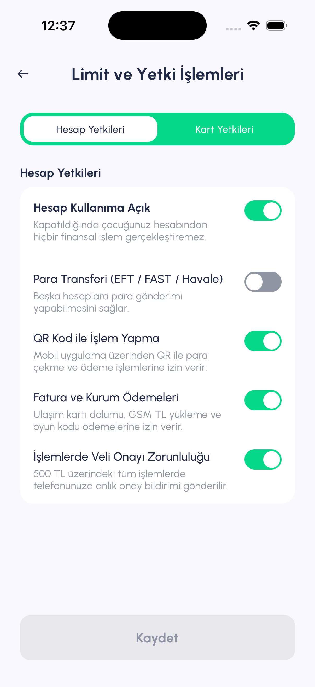
  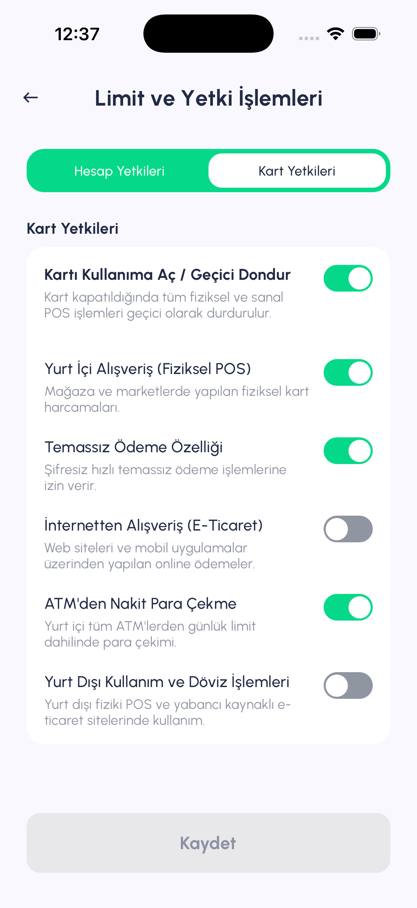
</p>

### Transactions & Filtering

<p align="center">
  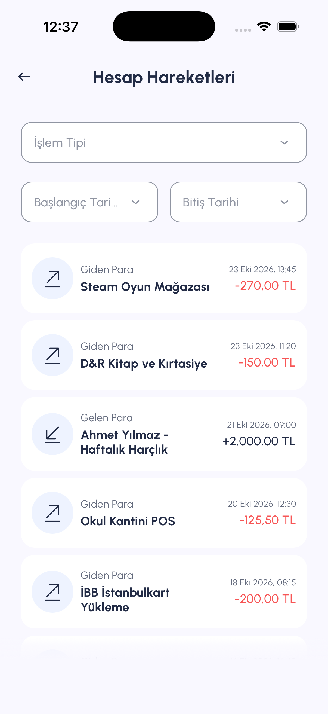
  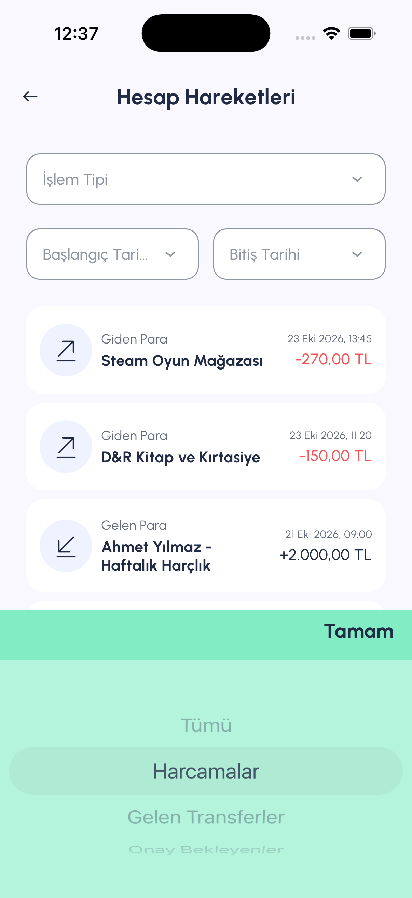
  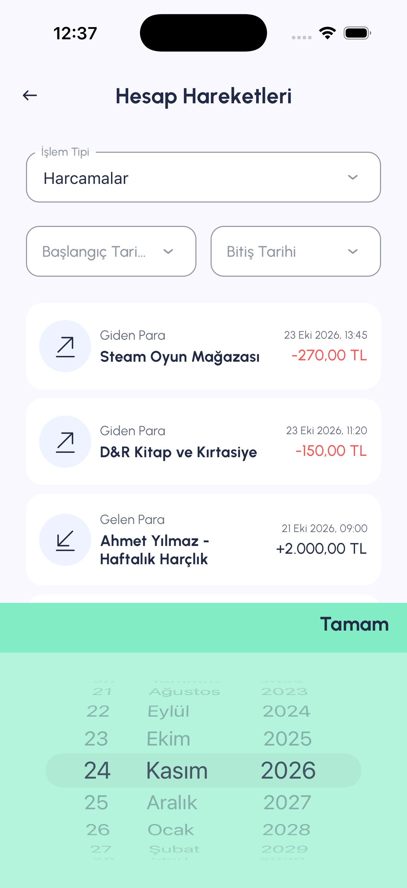
  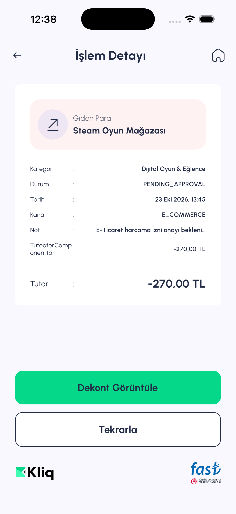
</p>

## Technology Stack

| Category              | Technology                                                                                                                                            |
| --------------------- | ----------------------------------------------------------------------------------------------------------------------------------------------------- |
| Core                  | React 19.3.0, React Native 0.88.1, TypeScript                                                                                                         |
| Navigation            | `@react-navigation/native`, `@react-navigation/native-stack`, `@react-navigation/bottom-tabs`, `react-native-screens`, `react-native-gesture-handler` |
| Server State          | `@tanstack/react-query`, `axios`                                                                                                                      |
| Client State          | `zustand`                                                                                                                                             |
| Persistence           | `@react-native-async-storage/async-storage`                                                                                                           |
| Forms & Validation    | `react-hook-form`, `zod`, `@hookform/resolvers`, `react-native-mask-input`                                                                            |
| Styling               | `styled-components`                                                                                                                                   |
| UI Utilities          | `react-native-paper`, `react-native-toast-message`, `@react-native-community/datetimepicker`, `@react-native-picker/picker`                           |
| Graphics / SVG        | `react-native-svg`, `react-native-svg-transformer`                                                                                                    |
| Layout Utilities      | `react-native-safe-area-context`                                                                                                                      |
| Environment Variables | `react-native-dotenv`                                                                                                                                 |
| Testing               | `jest`, `react-test-renderer`, `@react-native/jest-preset`                                                                                            |
| Code Quality          | `eslint`, `prettier`, `@typescript-eslint`                                                                                                            |

## Project Structure

```text
src/
  app/
    components/        # MainTabHeader, NavigationBar (with showHomeIcon support)
    navigation/        # RootNavigator (tabs + family stack), routes, types
      family-navigation/  # FamilyNavigator, useFamilyInitialRoute
  assets/
    fonts/             # Urbanist font family
    icons/             # SVG icons (flags, transactions, family dashboard, info)
    theme/             # Colors, theme typing, useTheme
  core/
    api/               # globalAxios (interceptors, global loading, error toasts)
    store/             # zustand stores: children, familyLimitAuthority, loading
    constants.ts       # API endpoint definitions
    utils.ts           # Error message helpers
  features/
    accounts/          # Accounts tab (entry to Kliq Ailem, storage reset)
    cards/             # Cards tab
    transactions/      # Transactions tab
    family/
      screens/         # Onboarding, list, add member, detail, limits & permissions,
                       # transactions, transaction detail (+ screen-local components/hooks)
      services/        # childrenService, familyLimitAuthorityService,
                       # familyMemberTransactionService
      types/           # Feature type definitions
  mocks/               # Reference mock JSON data (children, permissions, onboarding, transactions)
  shared/
    components/        # Button, Text, TextInput, PhoneInput, DatePicker, SelectPicker,
                       # Toggle, Tabs, TabBar, Screen, Loading, ListItem, InfoCard,
                       # InfoModal, MenuItem, TransactionListItem
    hooks/             # useDisableBackNavigation, useTheme
    utils/             # toast, identity/IBAN/name helpers
  storage.ts           # AsyncStorage keys
android/               # Native Android project
ios/                   # Native iOS project (CocoaPods)
```

## Installation

> **Note**: Before getting started, make sure you have completed the [React Native environment setup](https://reactnative.dev/docs/set-up-your-environment) guide.

```sh
npm install
```

For iOS, CocoaPods dependencies need to be installed (run this during the initial setup or after native dependency updates):

```sh
bundle install
bundle exec pod install
```

## Environment Variables

The project uses `react-native-dotenv` to read the `API_BASE_URL` variable from the `.env` file through the `@env` module.

Create a `.env` file in the project root and define the API base URL:

```env
API_BASE_URL=https://dummyjson.com/
```

Mock endpoints are served as [dummyjson custom responses](https://dummyjson.com/custom-response) and are defined in `src/core/constants.ts`.

## Running the App

Start the Metro development server:

```sh
npm start
```

Then, in a separate terminal, build and run the application:

```sh
npm run android
# or
npm run ios
```

## NPM Scripts

| Script            | Description                        |
| ----------------- | ---------------------------------- |
| `npm start`       | Starts the Metro bundler           |
| `npm run android` | Builds and runs the app on Android |
| `npm run ios`     | Builds and runs the app on iOS     |
| `npm test`        | Runs Jest test suites              |
| `npm run lint`    | Runs static analysis with ESLint   |

## Code Quality

Code style is maintained and checked using ESLint (`@react-native/eslint-config`, `@typescript-eslint`, `eslint-plugin-import` with enforced import ordering) and Prettier:

```sh
npm run lint
```

## Developer Notes

### API & State Management

- An `axios` + `@tanstack/react-query` data layer was set up. Instead of hardcoded mock data, GET requests are made to mock endpoints hosted on dummyjson, and the responses are persisted into the relevant `zustand` stores.
- On first launch, default mock data is fetched from the services and used to initialize the stores. The stores are subsequently updated after mutations such as adding a child or changing limits/permissions.

### Navigation & Flow

- Whether the family onboarding (dashboard) has been completed is persisted with `AsyncStorage`. The family stack's initial route is resolved from this flag: the onboarding screen if not completed, the child list screen otherwise. The "Belleği Temizle" button on the Accounts screen clears this flag, allowing the onboarding flow to be re-entered.
- When a child is added successfully and the user navigates to the permissions screen, the permission service is called and mapped for the newly added child; the add screen is removed from the navigation stack so the user cannot navigate back to it.
- The Home button in the `NavigationBar` is prop-driven: screens that pass `showHomeIcon: true` display it, and pressing it resets the navigation tree and returns to the main screen.
- On the limits & permissions screen, the hardware back button / back gesture stays enabled while there are no changes; once a change is made it is disabled, preventing the user from leaving the screen with unsaved changes.

### Business Rules

- The "Kliq Aileme Ekle" button is controlled by the `maxAllowedChildren` value; when the limit is reached, the button is disabled.
- Toggle dependencies (`dependsOn`) are fully enforced: enabling a dependent toggle also enables the toggle it depends on, and disabling a parent permission disables its dependents. When the master toggle is turned off, all toggles are turned off. Toggles with `requiresConfirmationOnEnable: true` open a confirmation modal before being enabled.
- Empty states are shown when the transactions or limits services return no data.
- In the transaction filters, the start and end dates are linked and constrained to a maximum 3-month range to avoid overloading the service. The "Listele" button is hidden by default and appears once a date picker value is selected; after filtering, the button switches to "Temizle" to clear the active filter.

### UX & Components

- A global loading component was added to prevent double-submits during service calls and to give the user clear feedback that a request is in flight; it is driven by a store so it can be controlled from different usage contexts.
- Since the country-code selector of the phone input on the add family member screen had no existing design or data, a custom modal design was implemented.
- Components such as buttons and text views were stress-tested with worst-case content (e.g., very long strings) and made flexible.
- Shared components are defined globally, while screen-specific components live next to their screens; recurring components are structured so they can be promoted to the global level.

### Tooling & Conventions

- Commit messages use the `BPN` prefix and can be matched to task numbers in branch names and commits, making them easy to trace later.
- ESLint rules were configured and the custom (Urbanist) font was added.
- Third-party libraries were selected with attention to how actively they are maintained and their weekly/total download counts.

### Mock Data

- A few additional props were added to the dashboard mock data; since the Figma design did not fully match, the UI was revised according to the JSON structure.
- A `statuses` object with distinct states was added to the children mock data. On the add family member screen, records that do not match the mock data's expected "success" entries are generated randomly and added to the children store; newly added records are set to a "pending approval" status, and adding multiple records with the same TCKN is prevented.
