# bpnProject — Kliq Ailem

> 🇬🇧 For the English version, see [README.md](./README.md)

React Native ile geliştirilmiş, aile bankacılığına ("Kliq Ailem") odaklanan bir mobil bankacılık uygulaması modülü. Ebeveynler ailelerine çocuk ekleyebilir, çocuk bazında limit ve yetkileri yönetebilir ve hesap hareketlerini inceleyebilir. Uygulama; alt sekme yapısı (Hesaplarım, Kartlarım, İşlemler) ve tanıtım → çocuk listesi → çocuk yönetimi akışının tamamını kapsayan ayrı bir aile navigasyon yığını ile birlikte gelir.

## İçindekiler

- [Özellikler](#özellikler)
- [Ekran Görüntüleri](#ekran-görüntüleri)
- [Teknoloji Yığını](#teknoloji-yığını)
- [Proje Yapısı](#proje-yapısı)
- [Kurulum](#kurulum)
- [Ortam Değişkenleri](#ortam-değişkenleri)
- [Uygulamayı Çalıştırma](#uygulamayı-çalıştırma)
- [NPM Komutları](#npm-komutları)
- [Kod Kalitesi](#kod-kalitesi)
- [Geliştirici Notları](#geliştirici-notları)

## Özellikler

- **Ana sekmeler (Bottom Tabs)**: Özel tab bar (`TabBar`) ve başlık (`MainTabHeader`) ile `Hesaplarım`, `Kartlarım` ve `İşlemler` sekmeleri arasında gezinme. Hesaplarım ekranı, Kliq Ailem akışına giriş noktası ve tanıtım (onboarding) durumunu sıfırlamak için "Belleği Temizle" aksiyonunu sunar.
- **Aile tanıtımı (dashboard)**: Slider tabanlı tanıtım akışı (`KliqFamilyOnboardingScreen`). Tamamlanma durumu `AsyncStorage` ile saklanır; aile yığınının başlangıç rotası çalışma zamanında belirlenir (`useFamilyInitialRoute`) — tamamlanmadıysa tanıtım, tamamlandıysa çocuk listesi ekranı.
- **Çocuk listesi**: Aile üyelerini avatar ve durum rozetleriyle listeler (`KliqFamilyListScreen`). "Kliq Aileme Ekle" butonu, `maxAllowedChildren` sınırına ulaşıldığında otomatik olarak pasif hale gelir.
- **Aile üyesi ekleme**: `react-hook-form` + `zod` doğrulamasıyla form tabanlı çocuk kaydı (`AddKliqFamilyMemberScreen`); özel alan kodu seçim modalı içeren maskeli telefon girişi dahildir. Aynı TCKN ile birden fazla kayıt eklenmesi engellenir.
- **Limit ve yetkiler**: Master/bağımlı toggle mantığı (`dependsOn`), onay modalları (`requiresConfirmationOnEnable`) ve kaydedilmemiş değişiklik varken fiziksel geri tuşunun engellenmesiyle çocuk bazında limit ve yetki yönetimi (`KliqFamilyLimitAuthorityScreen`).
- **Hesap hareketleri**: Tarih aralığı filtreleme (maksimum 3 aylık pencere), boş durum (empty state) gösterimi ve bağlama duyarlı "Listele"/"Temizle" filtre butonu içeren işlem listesi ve detay ekranları (`KliqFamilyTransactionScreen`, `KliqFamilyTransactionDetailScreen`).
- **Sunucu durumu ve store'lar**: Veriler, global `axios` örneği ve `@tanstack/react-query` hook'ları aracılığıyla mock REST API'den (dummyjson özel yanıtları) çekilir, ardından `zustand` store'larına (`childrenStore`, `familyLimitAuthorityStore`, `loadingStore`) kaydedilir.
- **Global yükleme ve hata yönetimi**: Axios interceptor'ları, global `Loading` katmanını (minimum gösterim süresiyle) yönetir ve API hatalarını `react-native-toast-message` ile kullanıcıya iletir.
- **Ortak bileşen kütüphanesi**: `Button`, `Text`, `TextInput`, `PhoneInput`, `DatePicker`, `SelectPicker`, `Toggle`, `Tabs`, `ListItem`, `InfoCard`, `InfoModal` ve `TransactionListItem` gibi yeniden kullanılabilir, tema uyumlu bileşenler.
- **Tema sistemi**: `styled-components` `ThemeProvider` üzerinden sağlanan merkezi renk paleti ve tipografi (Urbanist font ailesi).

## Ekran Görüntüleri

### Ana Sekmeler

<p align="center">
  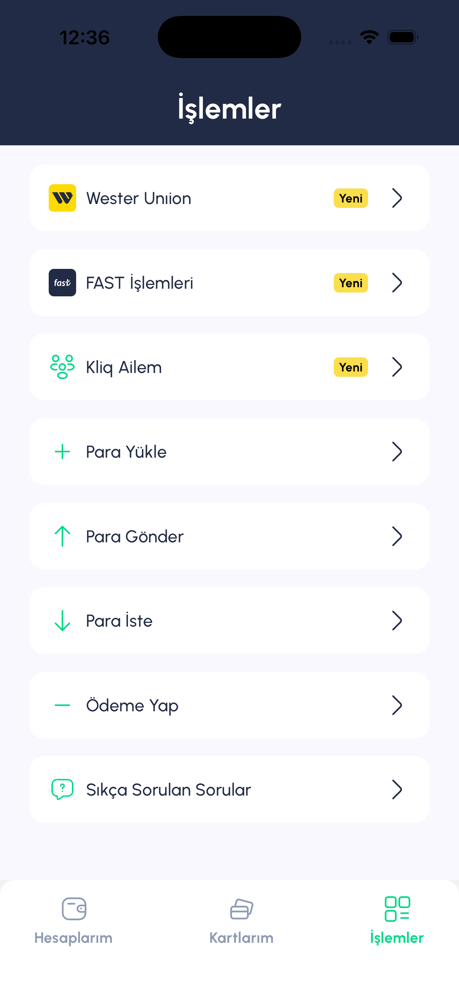
</p>

### Aile Tanıtımı (Dashboard)

<p align="center">
  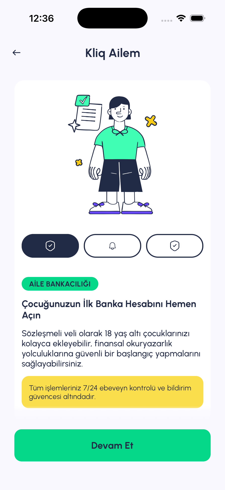
  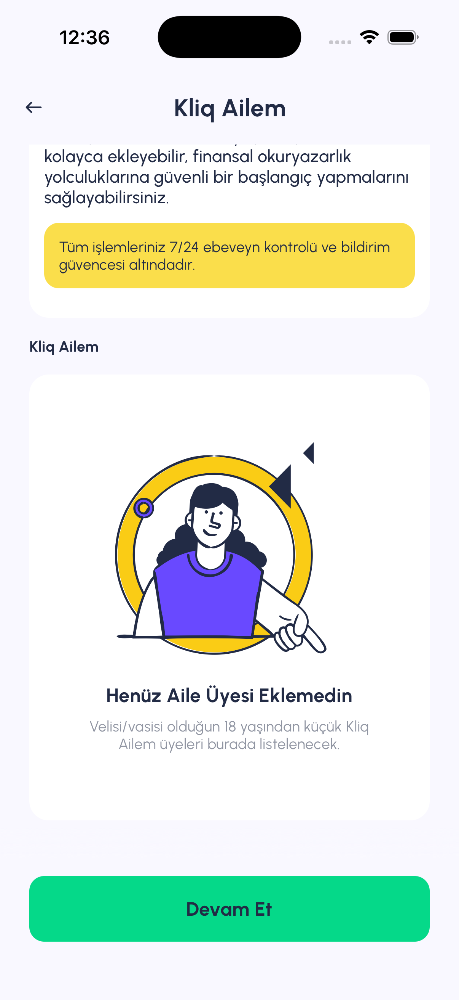
</p>

### Çocuk Listesi ve Aile Üyesi Ekleme

<p align="center">
  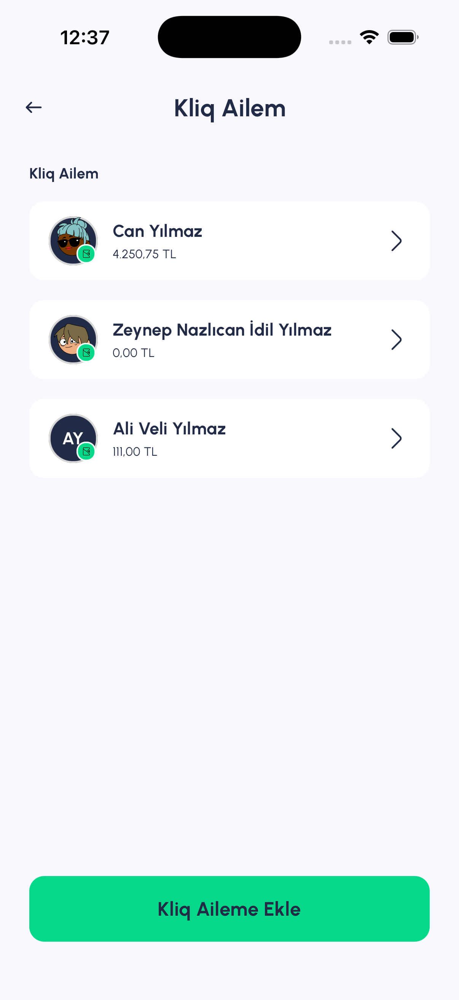
  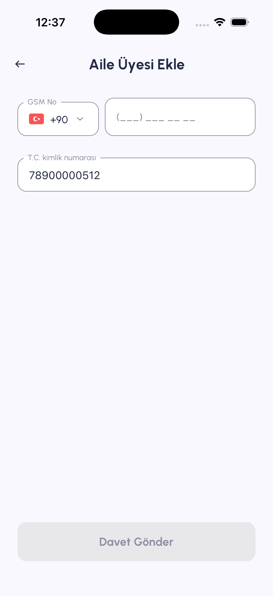
  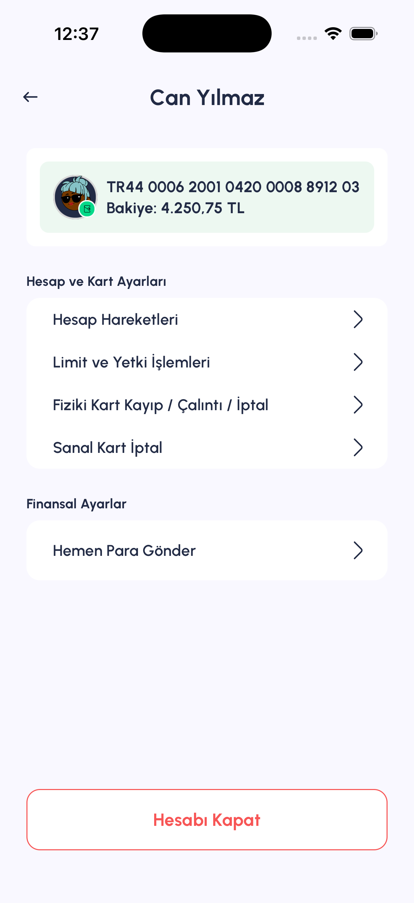
</p>

### Limit ve Yetkiler

<p align="center">
  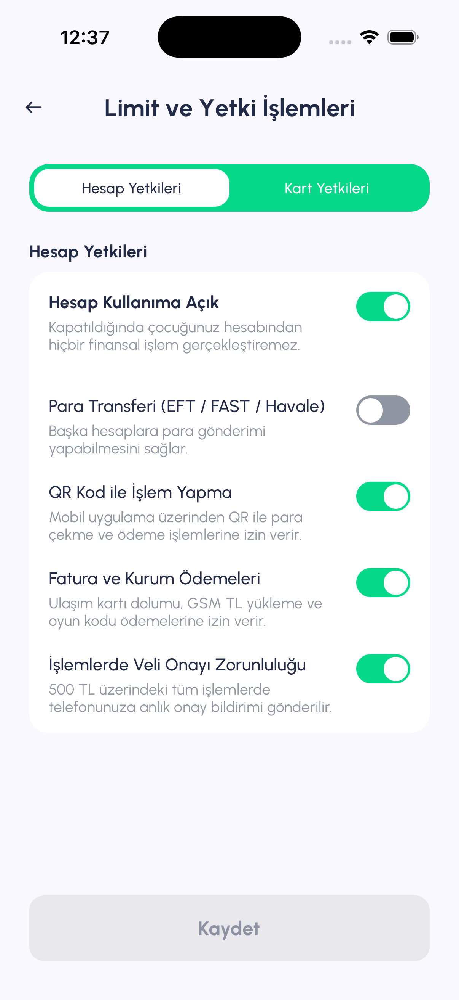
  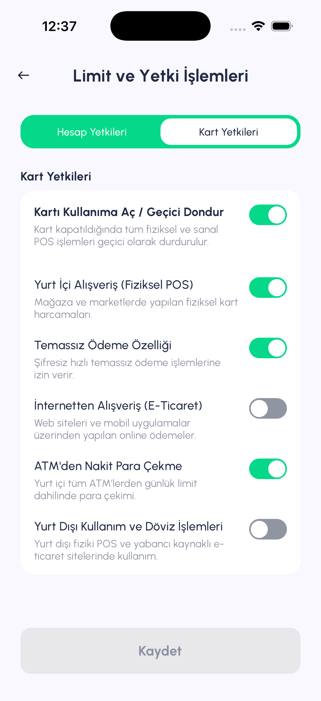
</p>

### Hesap Hareketleri ve Filtreleme

<p align="center">
  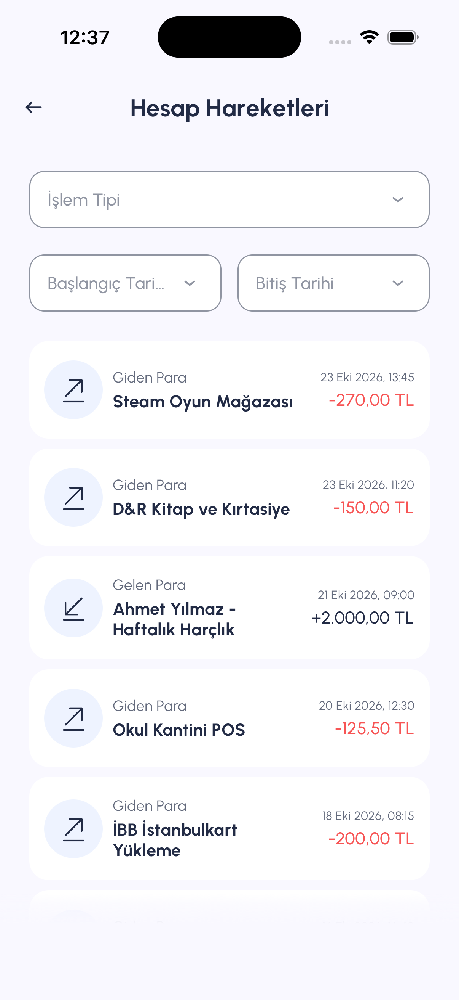
  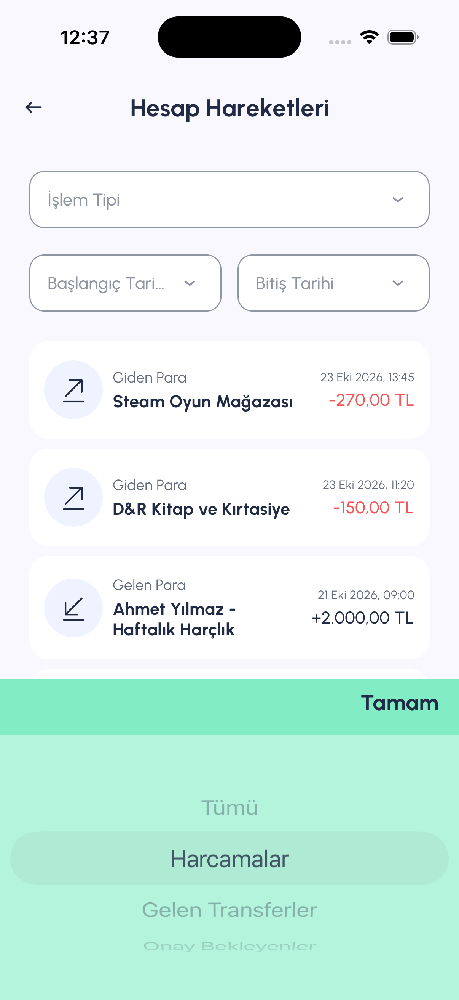
  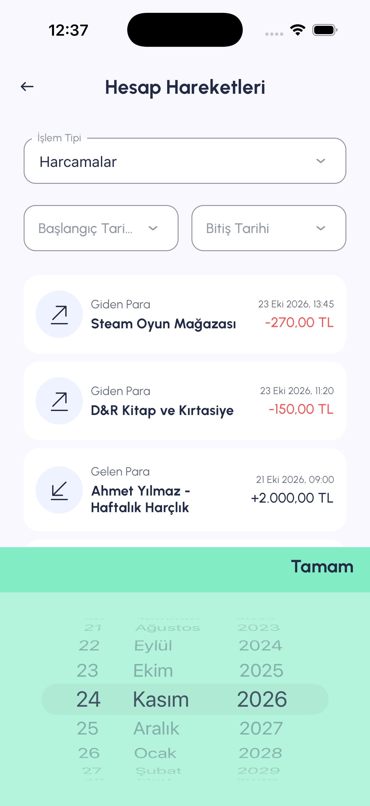
  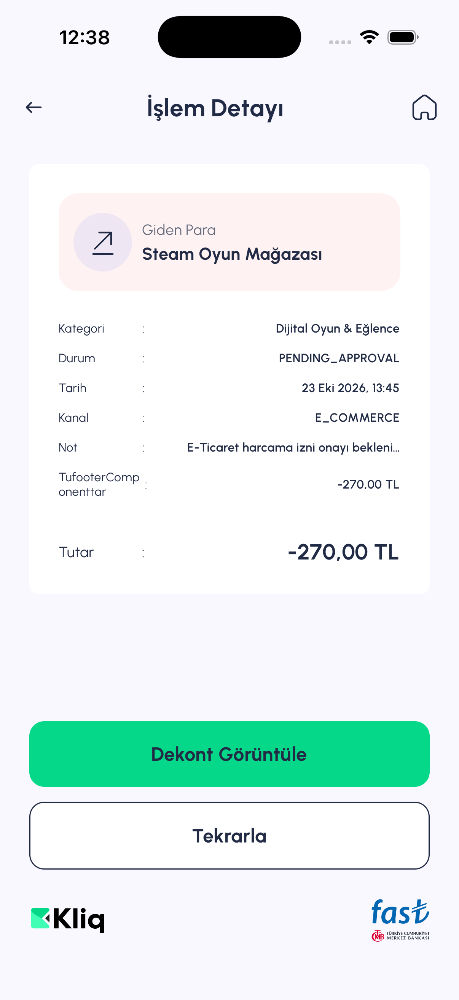
</p>

## Teknoloji Yığını

| Kategori              | Teknoloji                                                                                                                                             |
| --------------------- | ----------------------------------------------------------------------------------------------------------------------------------------------------- |
| Çekirdek              | React 19.3.0, React Native 0.88.1, TypeScript                                                                                                         |
| Navigasyon            | `@react-navigation/native`, `@react-navigation/native-stack`, `@react-navigation/bottom-tabs`, `react-native-screens`, `react-native-gesture-handler` |
| Sunucu Durumu         | `@tanstack/react-query`, `axios`                                                                                                                      |
| İstemci Durumu        | `zustand`                                                                                                                                             |
| Kalıcı Depolama       | `@react-native-async-storage/async-storage`                                                                                                           |
| Form ve Doğrulama     | `react-hook-form`, `zod`, `@hookform/resolvers`, `react-native-mask-input`                                                                            |
| Stil                  | `styled-components`                                                                                                                                   |
| UI Yardımcıları       | `react-native-paper`, `react-native-toast-message`, `@react-native-community/datetimepicker`, `@react-native-picker/picker`                           |
| Grafik / SVG          | `react-native-svg`, `react-native-svg-transformer`                                                                                                    |
| Yerleşim Yardımcıları | `react-native-safe-area-context`                                                                                                                      |
| Ortam Değişkenleri    | `react-native-dotenv`                                                                                                                                 |
| Test                  | `jest`, `react-test-renderer`, `@react-native/jest-preset`                                                                                            |
| Kod Kalitesi          | `eslint`, `prettier`, `@typescript-eslint`                                                                                                            |

## Proje Yapısı

```text
src/
  app/
    components/        # MainTabHeader, NavigationBar (showHomeIcon desteğiyle)
    navigation/        # RootNavigator (sekmeler + aile yığını), rotalar, tipler
      family-navigation/  # FamilyNavigator, useFamilyInitialRoute
  assets/
    fonts/             # Urbanist font ailesi
    icons/             # SVG ikonlar (bayraklar, işlemler, aile dashboard, bilgi)
    theme/             # Renkler, tema tipleri, useTheme
  core/
    api/               # globalAxios (interceptor'lar, global loading, hata toast'ları)
    store/             # zustand store'ları: children, familyLimitAuthority, loading
    constants.ts       # API endpoint tanımları
    utils.ts           # Hata mesajı yardımcıları
  features/
    accounts/          # Hesaplarım sekmesi (Kliq Ailem girişi, bellek sıfırlama)
    cards/             # Kartlarım sekmesi
    transactions/      # İşlemler sekmesi
    family/
      screens/         # Tanıtım, liste, üye ekleme, detay, limit ve yetkiler,
                       # hesap hareketleri, işlem detayı (+ ekrana özel bileşen/hook'lar)
      services/        # childrenService, familyLimitAuthorityService,
                       # familyMemberTransactionService
      types/           # Özellik bazlı tip tanımları
  mocks/               # Referans mock JSON verileri (children, permissions, onboarding, transactions)
  shared/
    components/        # Button, Text, TextInput, PhoneInput, DatePicker, SelectPicker,
                       # Toggle, Tabs, TabBar, Screen, Loading, ListItem, InfoCard,
                       # InfoModal, MenuItem, TransactionListItem
    hooks/             # useDisableBackNavigation, useTheme
    utils/             # toast, kimlik/IBAN/isim yardımcıları
  storage.ts           # AsyncStorage anahtarları
android/               # Native Android projesi
ios/                   # Native iOS projesi (CocoaPods)
```

## Kurulum

> **Not**: Başlamadan önce [React Native ortam kurulumu](https://reactnative.dev/docs/set-up-your-environment) rehberini tamamladığınızdan emin olun.

```sh
npm install
```

iOS için CocoaPods bağımlılıklarının kurulması gerekir (ilk kurulumda veya native bağımlılık güncellemelerinden sonra çalıştırın):

```sh
bundle install
bundle exec pod install
```

## Ortam Değişkenleri

Proje, `.env` dosyasındaki `API_BASE_URL` değişkenini `@env` modülü üzerinden okumak için `react-native-dotenv` kullanır.

Proje kök dizininde bir `.env` dosyası oluşturup API temel URL'ini tanımlayın:

```env
API_BASE_URL=https://dummyjson.com/
```

Mock endpoint'ler [dummyjson özel yanıtları](https://dummyjson.com/custom-response) olarak sunulur ve `src/core/constants.ts` dosyasında tanımlıdır.

## Uygulamayı Çalıştırma

Metro geliştirme sunucusunu başlatın:

```sh
npm start
```

Ardından ayrı bir terminalde uygulamayı derleyip çalıştırın:

```sh
npm run android
# veya
npm run ios
```

## NPM Komutları

| Komut             | Açıklama                                  |
| ----------------- | ----------------------------------------- |
| `npm start`       | Metro bundler'ı başlatır                  |
| `npm run android` | Uygulamayı Android'de derleyip çalıştırır |
| `npm run ios`     | Uygulamayı iOS'ta derleyip çalıştırır     |
| `npm test`        | Jest test paketlerini çalıştırır          |
| `npm run lint`    | ESLint ile statik analiz çalıştırır       |

## Kod Kalitesi

Kod stili; ESLint (`@react-native/eslint-config`, `@typescript-eslint`, import sıralaması zorunlu `eslint-plugin-import`) ve Prettier ile korunur ve denetlenir:

```sh
npm run lint
```

## Geliştirici Notları

### API ve Durum Yönetimi

- `axios` + `@tanstack/react-query` tabanlı bir veri katmanı kuruldu. Hardcoded mock veriler yerine, dummyjson üzerinde barındırılan mock endpoint'lere GET istekleri atılır ve yanıtlar ilgili `zustand` store'larına kaydedilir.
- İlk açılışta varsayılan mock veriler servislerden çekilerek store'lar başlatılır. Çocuk ekleme veya limit/yetki değişikliği gibi işlemlerden sonra store'lar güncellenir.

### Navigasyon ve Akış

- Aile tanıtımının (dashboard) tamamlanıp tamamlanmadığı `AsyncStorage` ile saklanır. Aile yığınının başlangıç rotası bu bilgiye göre belirlenir: tamamlanmadıysa tanıtım ekranı, tamamlandıysa çocuk listesi ekranı. Hesaplarım ekranındaki "Belleği Temizle" butonu bu bilgiyi silerek tanıtım akışına yeniden girilmesini sağlar.
- Çocuk ekleme işlemi başarılı olduğunda ve kullanıcı izinler ekranına yönlendiğinde, yeni eklenen çocuk için permission servisine gidilip eşleme yapılır; ekleme ekranı navigasyon yığınından çıkarılarak kullanıcının geri dönmesi engellenir.
- `NavigationBar` içindeki Home butonu props ile yönetilir: `showHomeIcon: true` gönderen ekranlarda görünür ve basıldığında navigasyon ağacı temizlenerek ana sayfaya dönülür.
- Limit ve yetkiler ekranında herhangi bir değişiklik yoksa fiziksel geri tuşu / geri hareketi aktif kalır; değişiklik yapıldığında pasif hale gelir ve kullanıcının kaydedilmemiş değişikliklerle ekrandan ayrılması engellenir.

### İş Kuralları

- "Kliq Aileme Ekle" butonu `maxAllowedChildren` değeri ile kontrol edilir; sınıra ulaşıldığında buton pasif hale getirilir.
- Toggle bağımlılıkları (`dependsOn`) eksiksiz uygulanır: bağımlı bir toggle açıldığında bağlı olduğu toggle da açılır, üst izin kapatıldığında alt izinler de kapatılır. Master toggle kapatıldığında tüm toggle'lar kapanır. `requiresConfirmationOnEnable: true` olan toggle'lar açılmadan önce onay modalı gösterilir.
- Hesap hareketleri veya limit servisleri boş veri döndürdüğünde boş durum (empty state) gösterilir.
- İşlem filtrelerinde başlangıç ve bitiş tarihleri birbirine bağlıdır ve servisi yormamak için aralarında maksimum 3 aylık bir pencere ile sınırlandırılmıştır. "Listele" butonu varsayılan olarak gizlidir ve picker'lardan biri seçildiğinde görünür hale gelir; filtreleme sonrasında buton, aktif filtreyi temizleyen "Temizle" butonuna dönüşür.

### Kullanıcı Deneyimi ve Bileşenler

- Servis çağrıları sırasında çift tıklamayı engellemek ve kullanıcıya isteğin devam ettiğini açıkça göstermek için global bir yükleme (loading) bileşeni eklendi; store ile yönetildiğinden farklı kullanım alanlarından kontrol edilebilir.
- Aile üyesi ekleme ekranındaki telefon girişinin alan kodu seçicisinin mevcut bir tasarımı ve verisi olmadığından, özel bir modal tasarımı geliştirildi.
- Buton, metin görünümü gibi bileşenler kötü senaryolarla (ör. çok uzun içerik) test edilerek esnek hale getirildi.
- Ortak kullanılan bileşenler global düzeyde tanımlandı; ekrana özel bileşenler ilgili ekranın yanında konumlandırıldı. Tekrar eden bileşenler, global seviyeye taşınabilecek şekilde yapılandırıldı.

### Araçlar ve Konvansiyonlar

- Commit mesajlarında `BPN` prefix'i kullanılır; branch adları ve commit'ler task numarasıyla eşleştirilebilir, bu da ileride geriye dönük takibi kolaylaştırır.
- ESLint kuralları yapılandırıldı ve özel (Urbanist) font eklendi.
- Üçüncü taraf kütüphaneler; güncel olarak bakım görmelerine ve haftalık/toplam indirme sayılarına dikkat edilerek seçildi.

### Mock Veriler

- Dashboard mock verisine birkaç ek prop eklendi; Figma tasarımı birebir uymadığından arayüz JSON yapısına göre revize edildi.
- Children mock verisine farklı durumları içeren bir `statuses` objesi eklendi. Aile üyesi ekleme ekranında, mock verideki "success" beklenen kayıtlarla eşleşmeyen veriler rastgele üretilerek children store'una eklenir; yeni eklenen kayıtlar "onay bekliyor" durumuna alınır ve aynı TCKN ile birden fazla kayıt eklenmesi engellenir.
